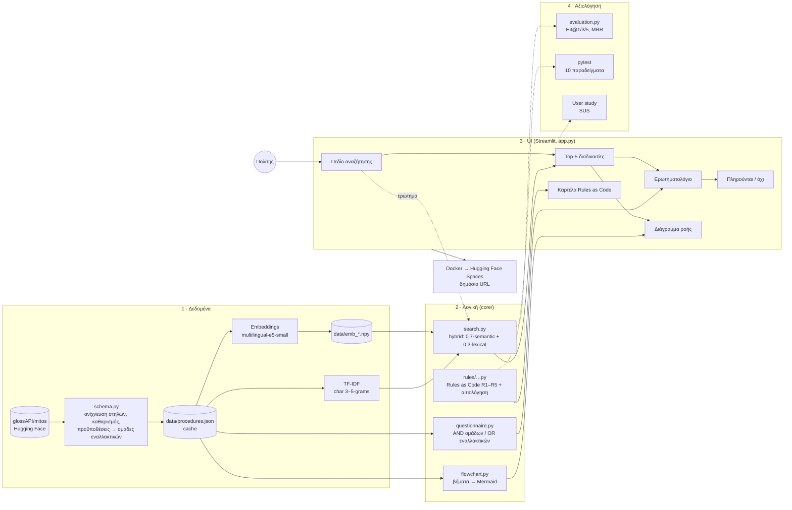

# Έλεγχος Προϋποθέσεων Διοικητικών Διαδικασιών: Rules as Code με βάση το ΜΙΤΟΣ

**🔗 Live demo:** https://huggingface.co/spaces/Depp87988/mitos3

> Το online demo είναι η εφαρμογή για χρήστες (JavaScript, δείγμα 12 διαδικασιών). Η πλήρης υλοποίηση σε Python, με το dataset glossAPI/mitos, embeddings, Rules as Code, tests και αξιολόγηση, βρίσκεται σε αυτό το repository.

Ο πολίτης περιγράφει την ανάγκη του («θέλω βεβαίωση ανεργίας»). Η εφαρμογή βρίσκει τις σχετικές διαδικασίες του **Εθνικού Μητρώου Διοικητικών Διαδικασιών (ΜΙΤΟΣ)** και εμφανίζει ένα ερωτηματολόγιο «πληρώ τις προϋποθέσεις;», που παράγεται αυτόματα από τη λίστα προϋποθέσεων. Στο τέλος απαντά αν οι προϋποθέσεις πληρούνται και δείχνει τα βήματα της διαδικασίας σε διάγραμμα ροής. Για μία απλή διαδικασία («Έκδοση βεβαίωσης ανεργίας») οι προϋποθέσεις έχουν γραφτεί πλήρως ως κώδικας (**Rules as Code**) και ελέγχονται σε 10 παραδείγματα.

**Dataset:** [`glossAPI/mitos`](https://huggingface.co/datasets/glossAPI/mitos) · **Έννοιες:** σημασιολογική αναζήτηση, κανόνες ως κώδικας, αξιολόγηση

---

## Γρήγορη εκκίνηση

**Windows:** διπλό κλικ στο `run_windows.bat` · **Mac/Linux:** `bash run_mac_linux.sh`


```bash
python -m venv .venv && source .venv/bin/activate      # Windows: .venv\Scripts\activate
pip install -r requirements.txt
python scripts/explore.py          # Βήμα 1: κατεβάζει το dataset, αναφορά + data/procedures.json
pytest -v                          # Βήμα 4: 10 παραδείγματα Rules as Code + έλεγχοι
python scripts/evaluate.py         # Βήμα 5: Hit@k / MRR + ακρίβεια κανόνων
streamlit run app.py               # εφαρμογή στο http://localhost:8501
```

Χωρίς internet η εφαρμογή χρησιμοποιεί αυτόματα το `data/sample_procedures.json` (12 διαδικασίες σε μορφή ΜΙΤΟΣ).
Μεταβλητές περιβάλλοντος: `DATA_SOURCE=auto|hf|cache|sample`, `USE_EMBEDDINGS=1|0`.

## Δομή

```
app.py                              Streamlit UI (4 καρτέλες)
core/
  schema.py                         κανονικοποίηση εγγραφής ΜΙΤΟΣ → Procedure (αυτόματη ανίχνευση στηλών)
  data.py                           φόρτωση HF / cache / δείγματος
  search.py                         σημασιολογική αναζήτηση (e5 embeddings + TF-IDF hybrid)
  questionnaire.py                  προϋποθέσεις → ερωτήσεις → απόφαση (AND ομάδων / OR εναλλακτικών)
  flowchart.py                      βήματα → Mermaid
  rules/unemployment_certificate.py Rules as Code + 10 παραδείγματα
  evaluation.py                     Hit@k, MRR, ακρίβεια κανόνων
scripts/explore.py                  Βήμα 1: εξερεύνηση dataset
scripts/evaluate.py                 Βήμα 5: αξιολόγηση
tests/                              pytest (18 tests)
eval/queries.csv                    ερωτήσεις αξιολόγησης με ground truth
Dockerfile                          deploy (Docker)
web/index.html                      online demo για χρήστες (Hugging Face Static Space)
```

---

## Αρχιτεκτονική



| Επίπεδο | Αρχείο | Ρόλος |
|---|---|---|
| Δεδομένα | `core/schema.py`, `core/data.py` | Φόρτωση, ανίχνευση σχήματος, κανονικοποίηση, cache |
| Αναζήτηση | `core/search.py` | Embeddings + TF-IDF, hybrid βαθμολογία |
| Ερωτηματολόγιο | `core/questionnaire.py` | Αυτόματη παραγωγή ερωτήσεων και απόφαση |
| Κανόνες | `core/rules/unemployment_certificate.py` | Rules as Code με τύπους, νομική βάση, εξήγηση |
| Οπτικοποίηση | `core/flowchart.py` | Mermaid flowchart με ρόμβους ελέγχου |
| UI | `app.py` | Streamlit, 4 καρτέλες |
| Αξιολόγηση | `core/evaluation.py`, `tests/` | Μετρικές και unit tests |

---

## Αναλυτικά βήματα που ακολουθήθηκαν

### Βήμα 1: Εξερεύνηση του dataset
**Στόχος:** να καταλάβω τι περιέχει μια διαδικασία: προϋποθέσεις, βήματα, νομοθεσία.

1. Φόρτωση με `datasets.load_dataset("glossAPI/mitos")` και εκτύπωση των `features` και ενός ωμού παραδείγματος (`scripts/explore.py`).
2. **Αντιστοίχιση στηλών:** το `schema.py` αναγνωρίζει αυτόματα τα πεδία (title, requirements/προϋποθέσεις, steps/βήματα, legislation/νομοθεσία, …) με βάση τα ονόματα των στηλών. Αν το dataset έχει μόνο μία στήλη κειμένου (markdown), τη χωρίζει σε ενότητες με βάση τις επικεφαλίδες «Προϋποθέσεις», «Βήματα», «Νομοθεσία». Αν κάτι αντιστοιχιστεί λάθος, διορθώνεται με το `schema_override.json`.
3. **Αναπαράσταση προϋποθέσεων:** λίστα **ομάδων**, με AND μεταξύ ομάδων και OR μέσα σε κάθε ομάδα (εναλλακτικές). Οι εναλλακτικές αναγνωρίζονται από δομή (`alternatives`, εμφωλευμένες λίστες) ή από κείμενο (γραμμές που ξεκινούν με «Ή…» / «Εναλλακτικά…»). Προσοχή: το άρθρο «Η» δεν είναι το διαζευκτικό «Ή», γι' αυτό ο έλεγχος γίνεται με τον τόνο.
4. **Καθαρισμός:** αφαίρεση HTML/markdown, bullets και διπλοτύπων.
5. **Στατιστικά:** % διαδικασιών με προϋποθέσεις, βήματα και εναλλακτικές, κατανομή ανά φορέα, λίστα υποψηφίων για Rules as Code.

**Παραδοτέο:** `data/explore_report.md`, `data/procedures.json`

### Βήμα 2: Σημασιολογική αναζήτηση
**Στόχος:** ο πολίτης γράφει με δικά του λόγια («έχασα τη δουλειά μου») και βρίσκει την επίσημη διαδικασία («Τακτικό επίδομα ανεργίας»).

1. Για κάθε διαδικασία φτιάχνεται ένα κείμενο: τίτλος (×2 για βάρος) + περιγραφή + προϋποθέσεις.
2. **Semantic:** embeddings με `intfloat/multilingual-e5-small`, που είναι πολυγλωσσικό, υποστηρίζει ελληνικά και τρέχει σε CPU. Χρησιμοποιούνται τα προθέματα `passage:` / `query:` που απαιτεί το e5 και κανονικοποίηση L2, ώστε το εσωτερικό γινόμενο να είναι cosine. Τα embeddings αποθηκεύονται σε `.npy` για να υπολογίζονται μία φορά.
3. **Lexical:** TF-IDF σε n-grams χαρακτήρων (3–5) πάνω σε κείμενο χωρίς τόνους. Αντέχει στην ελληνική κλίση (ανεργία/ανέργων/άνεργος) και πιάνει ακριβείς όρους (ΑΜΚΑ, Α21).
4. **Hybrid:** `score = 0.7·semantic + 0.3·lexical` μετά από min-max κανονικοποίηση. Αν το μοντέλο δεν φορτώσει, η εφαρμογή συνεχίζει μόνο με το lexical (graceful degradation).
5. Για μερικές χιλιάδες διαδικασίες αρκεί αναζήτηση brute-force με numpy. FAISS θα χρειαζόταν μόνο σε πολύ μεγαλύτερη κλίμακα.

### Βήμα 3: Αυτόματο ερωτηματολόγιο
**Στόχος:** για **κάθε** διαδικασία να δημιουργείται αυτόματα ένα «πληρώ τις προϋποθέσεις;».

1. Υποχρεωτική προϋπόθεση → ερώτηση ναι/όχι. Αν η διατύπωση είναι ονοματική, γίνεται «Ισχύει για εσάς: «…»;».
2. Ομάδα εναλλακτικών → «Ισχύει τουλάχιστον ένα από τα παρακάτω;» με επιλογές + «Κανένα».
3. **Απόφαση:** `πληρούνται = AND(ομάδες)`. Εμφανίζεται **ποια** προϋπόθεση δεν πληρούται (εξήγηση). Αν μένουν αναπάντητες ερωτήσεις, η απόφαση εκκρεμεί.
4. Πιθανή βελτίωση: LLM για αναδιατύπωση σε φυσικές ερωτήσεις, offline και με ανθρώπινο έλεγχο.

### Βήμα 4: Rules as Code για μία απλή διαδικασία
**Επιλογή:** «Έκδοση βεβαίωσης ανεργίας». Έχει λίγες, σαφείς, ελέγξιμες προϋποθέσεις και ταιριάζει με το παράδειγμα της εκφώνησης.

1. Κάθε προϋπόθεση γίνεται **μεταβλητή με τύπο**: `age:int`, `citizenship:Enum{GR,EU,TCN}`, `registered/employed/retired:bool`.
2. Κάθε κανόνας έχει **κωδικό** (R1–R5), περιγραφή, **νομική βάση** (traceability) και συνάρτηση ελέγχου.
3. Η εναλλακτική προϋπόθεση (υπηκοότητα) γράφεται ως λογικό OR: `GR or EU or (TCN and work_permit)`.
4. Η `is_eligible()` επιστρέφει απόφαση **και αιτιολόγηση** (ποιοι κανόνες απέτυχαν).
5. **10 παραδείγματα** με αναμενόμενη απάντηση (4 θετικά, 6 αρνητικά). Περιλαμβάνουν οριακή τιμή (ακριβώς 18 ετών) και κάθε κανόνα που αποτυγχάνει τουλάχιστον μία φορά. Τρέχουν με `pytest -v` και εμφανίζονται στην εφαρμογή.
6. Στην εφαρμογή, δίπλα στους κανόνες, φαίνονται και οι προϋποθέσεις όπως είναι γραμμένες στο dataset, ώστε να ελέγχεται ότι η κωδικοποίηση είναι πιστή.

> ⚠ Οι κανόνες είναι εκπαιδευτική απλοποίηση (π.χ. ηλικία ≥ 18). Πριν την παράδοση, ελέγξτε τις προϋποθέσεις και τη νομοθεσία της πραγματικής εγγραφής στο ΜΙΤΟΣ και προσαρμόστε το `RULES`.

### Βήμα 5: Flowchart, δημοσίευση και αξιολόγηση
**Flowchart:** τα βήματα μετατρέπονται σε Mermaid. Βήματα «ελέγχου/εξέτασης/έγκρισης» παίρνουν ρόμβο απόφασης με κλάδο «Όχι → συμπλήρωση/απόρριψη».

**Δημοσίευση σε Hugging Face Spaces:**
1. huggingface.co → New Space → SDK: **Docker** → Blank.
2. `git clone https://huggingface.co/spaces/<user>/<space>` και αντιγραφή όλων των αρχείων του project.
3. `git add . && git commit -m "init" && git push`. Το Space χτίζεται από το `Dockerfile` (θύρα 7860) και η εφαρμογή γίνεται διαθέσιμη σε δημόσιο URL.
4. Στην πρώτη εκκίνηση κατεβαίνουν το dataset και το μοντέλο (~1–2 λεπτά).

*Εναλλακτικά:* Streamlit Community Cloud (σύνδεση με GitHub repo, main file `app.py`).

**Αξιολόγηση:**
| Τι | Πώς | Μετρική |
|---|---|---|
| Αναζήτηση | 14 ερωτήσεις πολιτών με ground truth (`eval/queries.csv`) | Hit@1, Hit@3, Hit@5, MRR |
| Rules as Code | 10 παραδείγματα | ακρίβεια (στόχος 10/10) |
| Ερωτηματολόγιο / UX | 5–10 χρήστες × 3 σενάρια | % σωστής εύρεσης, χρόνος, SUS, συμφωνία με τους κανόνες |

> Στο `eval/queries.csv` η στήλη `expected_title_contains` είναι τμήμα του τίτλου της σωστής διαδικασίας. Αφού τρέξετε το `explore.py`, ελέγξτε ότι ταιριάζει με τους **πραγματικούς** τίτλους του ΜΙΤΟΣ και προσθέστε δικές σας ερωτήσεις.

## Περιορισμοί
- Οι προϋποθέσεις στο ΜΙΤΟΣ είναι ελεύθερο κείμενο, οπότε η ανίχνευση εναλλακτικών είναι ευρετική.
- Το Rules as Code γίνεται χειροκίνητα ανά διαδικασία. Για κλιμάκωση υπάρχουν πλαίσια όπως OpenFisca ή Catala.
- Η απάντηση της εφαρμογής είναι **ενδεικτική** και δεν αποτελεί διοικητική πράξη.
